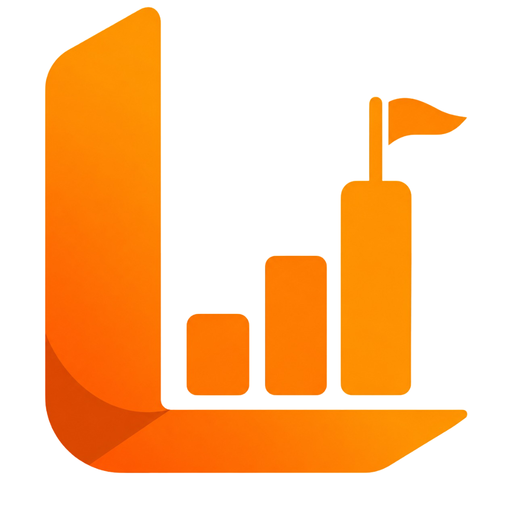
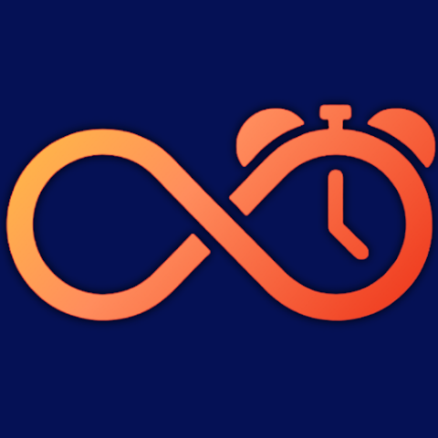
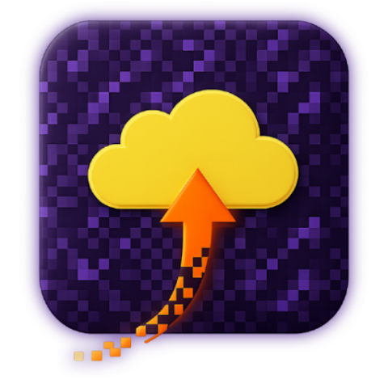
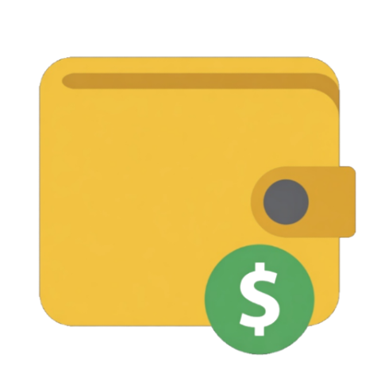

<div align="center">

<!-- 90s Animated Synthwave Banner -->


<br/>

```text
  ___ _____ _   _     _        _    ____  ____  
 / _ \__  /| \ | |   | |      / \  | __ )/ ___| 
| |_| |/ / |  \| |---| |     / _ \ |  _ \\___ \ 
|  _  / /_ | |\  |---| |___ / ___ \| |_) |___) |
|_| |_/____|_| \_|   |_____/_/   \_\____/|____/ 
  >> ARCHITECTURE • ANDROID • UTILITIES • WEB <<
```

<p align="center">
  <a href="https://azaanmr.github.io/"></a>
  <a href="https://github.com/azaanmr"></a>
  <a href="https://play.google.com/store/apps/dev?id=7607789726484682256"></a>
  <a href="mailto:muhammadazaanmr@gmail.com"></a>
</p>

</div>

---

## About Me

```ini
NAME        = "Muhammad Azaan M R"
ROLE        = "Software Developer & Builder"
BRAND       = "Founder @ AZN Labs"
FOCUS       = ["Open Source", "Android", "Modern Web", "Developer Tooling"]
OBJECTIVE   = "Turning ideas into usable, practical software products"
```

I am a software developer focused on building practical, reliable applications across Android, modern web, developer tooling, and standalone utilities. I prioritize real-world utility, intuitive user experience, and offline-first performance over tech experiments for their own sake.

I manage the complete development lifecycle: ideation, architecture, design, development, testing, and shipping to end users.

---

## Open-Source Projects

<table>
  <tr>
    <td width="100" align="center" valign="top">
      
    </td>
    <td valign="top">
      <h3><a href="https://github.com/azaanmr/LeetCompanies-Extension">LeetCompanies Extension</a></h3>
      <p>A lightweight Chrome extension that integrates company-wise interview tags, problem frequencies, and instant search directly into LeetCode challenge pages.</p>
      <p><b>Stack:</b> JavaScript, Chrome Extensions API, DOM Scripting</p>
      <p>
        <a href="https://github.com/azaanmr/LeetCompanies-Extension">
          
        </a>
      </p>
    </td>
  </tr>
</table>

### Other Open-Source & Web Projects
- **[Personal Website & Project Hub](https://azaanmr.github.io/)** — Personal portfolio, live demos, and documentation showroom.
- **Developer Utilities & Automation** — CLI scripts, workflow automations, and LLM-assisted developer tooling.

---

## Published Android Apps (AZN Labs)

> **AZN Labs** is my independent software imprint creating simple, useful, and thoughtfully engineered mobile applications.  
> [View Developer Profile on Google Play](https://play.google.com/store/apps/dev?id=7607789726484682256)

<table>
  <tr>
    <td width="33%" valign="top" align="center">
      
      <h3>Any Alarm</h3>
      <p align="left"><i>Customizable wake-up utility with challenges for heavy sleepers.</i></p>
      <ul align="left">
        <li>Math & logic challenges</li>
        <li>QR / Barcode scanning</li>
        <li>Step & movement counter</li>
        <li>GPS location alarms</li>
        <li>Light sensor & memory tests</li>
      </ul>
      <a href="https://play.google.com/store/apps/details?id=com.aznenterprises.anyalarm">
        
      </a>
    </td>
    <td width="33%" valign="top" align="center">
      
      <h3>MineSaves</h3>
      <p align="left"><i>Minecraft Bedrock world backup and management toolkit.</i></p>
      <ul align="left">
        <li>One-tap world backups</li>
        <li>Instant world restore</li>
        <li>Custom world thumbnails</li>
        <li>World file manager</li>
        <li>Addon & content discovery</li>
      </ul>
      <a href="https://play.google.com/store/apps/details?id=com.aznenterprises.mcpebackup">
        
      </a>
    </td>
    <td width="33%" valign="top" align="center">
      
      <h3>NET Expense Manager</h3>
      <p align="left"><i>Personal finance & expense tracker built for speed and privacy.</i></p>
      <ul align="left">
        <li>Quick income & expense logs</li>
        <li>Budget analytics & trends</li>
        <li>Home-screen widget</li>
        <li>Mess & meal accounting</li>
        <li>100% Offline & local data</li>
      </ul>
      <a href="https://play.google.com/store/apps/details?id=com.aznenterprises.tracksmith">
        
      </a>
    </td>
  </tr>
</table>

---

## Tech Stack

<div align="center">

#### Languages


#### Android & Mobile


#### Web & Architecture


#### Tools & Workflows


</div>

---

## Building Philosophy

```text
┌─────────────────────────────────────────────────────────────┐
│ 1. Practical Utility :: Build software that solves needs.   │
│ 2. Intuitive UI      :: Minimize friction, maximize clarity.│
│ 3. Privacy First     :: Offline-first whenever viable.      │
│ 4. Performance       :: Fast, lightweight, and responsive. │
│ 5. Build to Learn    :: Master architectures by shipping.   │
└─────────────────────────────────────────────────────────────┘
```

---

## GitHub Telemetry

<div align="center">
  
  
</div>

<br/>

<div align="center">
  
</div>

---

## Connect

<div align="center">

<p align="center">
  <a href="mailto:muhammadazaanmr@gmail.com"></a>
  <a href="https://azaanmr.github.io/"></a>
  <a href="https://play.google.com/store/apps/dev?id=7607789726484682256"></a>
  <a href="https://github.com/azaanmr"></a>
</p>

</div>
